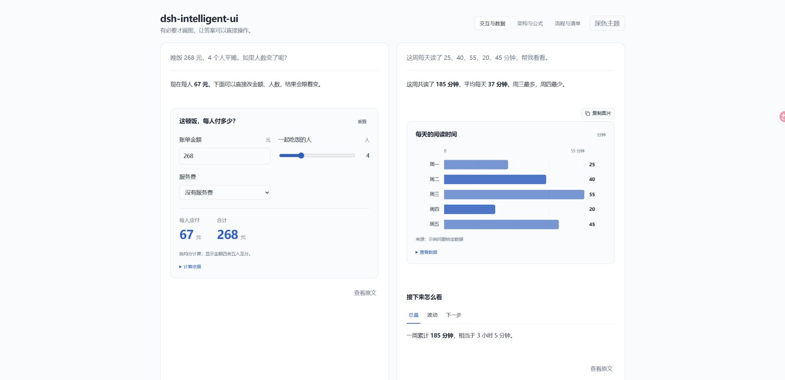
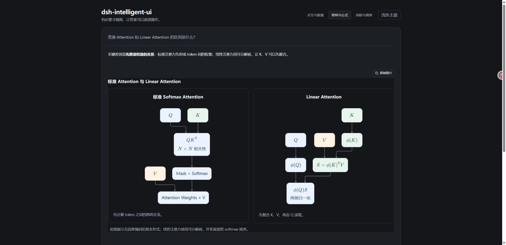

# dsh-intelligent-ui

**Adaptive charts, diagrams, math, images, and interactive answers inside DeepSeek Harness.**

[简体中文](README.md) · [Install](#install) · [Try-it prompts](#try-it-prompts) · [Contributing](CONTRIBUTING.md) · [Report a bug](https://github.com/cpsGGG/dsh-intelligent-ui/issues/new/choose)

[](LICENSE)
[](https://github.com/cpsGGG/dsh-intelligent-ui/actions/workflows/ci.yml)


Ask a normal question. IUI guides your existing DSH model to choose a useful presentation: a diagram for dependencies, a chart for comparable data, or an interactive calculator for changing assumptions. The result appears **inside the original assistant reply**.

**Visuals are optional. Simple questions should stay simple.**



*Component preview with synthetic example data. The standalone preview uses a demonstration Markdown adapter; production DSH supplies its native Markdown and math rendering.*

## What it adds

| Task | In-answer presentation |
| --- | --- |
| Explain mechanisms and dependencies | Flowcharts, clickable diagrams, two-panel architecture comparisons |
| Compare measurements or trends | Bar/line charts with units, provenance, and a data table |
| Explore changing assumptions | Number inputs, sliders, select controls, and live results |
| Read mathematical explanations | Typeset equations, including mathematical labels inside diagram nodes |
| Understand real-world appearance | Wikimedia Commons images with source, author, and license |
| Save a useful visual | Copy images or complete figures as PNG |
| Organize action and background | Checklists, tabs, and collapsible details |

Keep the plugin enabled. A visible **Intelligent UI** switch beside the conversation input controls turns the feature on or off for that conversation. New conversations default to on, and preferences persist.

## Install

**Current release: 0.6.1 Beta.** Primarily verified on **DSH 0.2.1-rc.3 Desktop / Windows**. Interfaces were also checked on 0.2.1-rc.2. The declared host range is `>=0.2.1-rc.2 <0.3.0`; other versions, operating systems, and plugin combinations need more testing.

Use an existing DSH installation with a configured model. IUI does not require an additional model API key.

```sh
dsh plugin --profile desktop add "github:cpsGGG/dsh-intelligent-ui#v0.6.1"
```

Replace `desktop` if your running application uses another profile. The tagged repository includes prebuilt `lib/` files: **end users do not need to build the plugin**.

If your client exposes an add-plugin-source field, use:

```text
github:cpsGGG/dsh-intelligent-ui#v0.6.1
```

On Windows, if `dsh` is not on PATH, use the CLI shipped with the desktop application. Replace the example installation path:

```powershell
& 'C:\path\to\DeepSeek Harness\resources\runtime\cli\bin\dsh.cmd' plugin --profile desktop add 'github:cpsGGG/dsh-intelligent-ui#v0.6.1'
```

Prefer the CLI from the same desktop distribution. See the [official DSH packaging and installation guide](https://github.com/deepseek-ai/deepseek-harness/blob/master/docs/user/develop/basic/publish.md).

After installation, confirm the plugin is enabled, open a conversation, and find the **Intelligent UI** switch below the input. If the host requires a restart, finish active tasks and restart DSH normally.

## Try-it prompts

> Dinner cost 268 yuan for four people, but more people might join. Let me adjust the group size and see the per-person amount.

> My daily reading times were 25, 40, 55, 20, and 45 minutes. Explain the pattern with an appropriate chart, keeping the units and original data.

> Explain standard Attention versus Linear Attention. Use a concise architecture comparison where useful and typeset the key equations.

> What does Mount Fuji look like? Show two real photos with sources and briefly describe its appearance.

> Help me prepare a small product for its first user test, with the key steps and a checklist I can tick off.

Component selection is model-dependent. Asking explicitly for a chart, a simple dependency diagram, or adjustable inputs makes the intention clearer. Text-only answers are valid when a visual adds little.



## How it works

1. The conversation preference determines whether DSH receives the [presentation rules](plugin/answer-style.md) for a subsequent model request.
2. The model writes normal Markdown plus selected structured components.
3. IUI validates complete components and renders them inline. Incomplete streaming components show a placeholder; unsupported or invalid output retains its source.

Ordinary Markdown, reasoning disclosure, attachments, file authorization, and math use native DSH components. Supported visual blocks are `iui-chart`, `iui-flow`, `iui-diagram`, `iui-compare`, `iui-interactive`, `iui-gallery`, `iui-tabs`, `iui-checklist`, and `iui-details`.

Turning the conversation switch off affects subsequent requests. Existing answers remain. Disabling the entire plugin removes its renderer; old visual blocks may then appear as their original protocol text.

## Copying and local interaction

- Use **复制图片** (Copy image) on displayed images or IUI figures, then paste into an application that accepts images.
- Figure export includes formulas, arrows, captions, and content wider than the visible panel.
- Supported images become PNG; GIF copying produces a static image. External image CORS and clipboard permissions still apply.
- Changing a slider or input updates local results without another model request or an automatically sent message.
- Input and checklist state is stored locally by conversation, message, and component. The conversation on/off preference uses DSH settings.

## Limits and troubleshooting

- **No visual appeared:** send a new request after enabling the switch. Previous answers are not regenerated. Simple answers may remain text. If raw `iui-*` code appears, check that the plugin and its client renderer are enabled.
- **Image scope:** the additional image tool searches Wikimedia Commons, not the entire web. It provides no additional text-to-image generation. Search relevance depends on keywords and source coverage.
- **Charts and expressions:** bar/line values must be non-negative. Calculators use a restricted expression parser; arbitrary JavaScript, HTML applications, maps, games, and complex simulations are unsupported.
- **Copy failure:** an image can display while its server prevents pixel access. The UI reports failure instead of copying a URL as an image. Limits are 32 MiB or 24 megapixels per copy.
- **Math:** DSH typesets TeX. Clearly identifiable legacy formula code blocks can be repaired for display, while real code, ambiguous content, and original answer text are preserved.
- **Models and themes:** native answer verification used DeepSeek-V4.1-Flash. Other models must follow the component protocol; image search requires tool calling. Light/dark presentation was checked. Third-party theme/rendering combinations need further testing. Version 0.6.1 removes unnecessary settings reloads on navigation; it does not claim to fix every host or theme-plugin issue.
- **Language:** many current control labels are Simplified Chinese. Answer content follows the model and your prompt. Localization contributions are welcome.
- **Sidebar examples:** the Intelligent UI sidebar is a component playground. Regular use happens in normal conversations; no separate web server is needed.

## Data and cost

DSH continues to call your selected model; the presentation rules add context tokens. Controls and PNG export run locally. Image search sends the model-selected query to Wikimedia Commons, and displaying images requests the corresponding image host. IUI has no separate conversation-upload or telemetry service. Keep private information out of public image searches.

## Update or remove

Check [Releases](https://github.com/cpsGGG/dsh-intelligent-ui/releases) for a new tag and installation command. Restart DSH after active tasks finish when updating host prompts/tools so cached modules are replaced.

```sh
dsh plugin --profile desktop remove dsh-intelligent-ui
```

Conversation source text is retained. To use ordinary answers in just one conversation, use its switch instead of removing the plugin.

## Develop

Use Node.js 22.12+ or 24:

```sh
git clone https://github.com/cpsGGG/dsh-intelligent-ui.git
cd dsh-intelligent-ui
npm ci
npm run check
```

Development dependencies are declared and locked. `npm test` rejects skipped tests. CI runs Linux/Windows with Node.js 22/24. The pre-publication local run passed 87 automated checks with zero skips; [integration notes](docs/dsh-integration.md) describe the native verification boundary.

```sh
npm run demo
```

Open <http://127.0.0.1:4173/assets/readme/demo.html> for an offline component preview using synthetic data. It does not connect to conversations or call a model. Set `PORT` to another port if needed.

See [CONTRIBUTING.md](CONTRIBUTING.md), [CHANGELOG.md](CHANGELOG.md), and [the issue forms](https://github.com/cpsGGG/dsh-intelligent-ui/issues/new/choose).

## License and affiliation

Original project code is licensed under [MIT](LICENSE). Bundled dependencies retain their own licenses; see [THIRD-PARTY-NOTICES](lib/THIRD-PARTY-NOTICES.txt).

This is an independent community plugin for DeepSeek Harness, with no official affiliation with DeepSeek or OpenAI. “Intelligent UI” describes this project's presentation approach.
